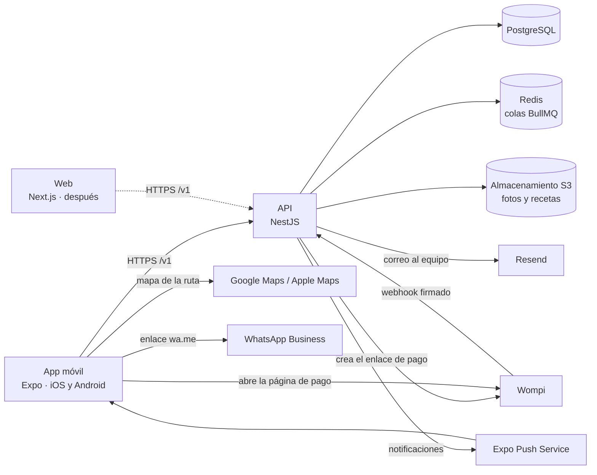

# Pawie Care: arquitectura y stack técnico

**Versión del documento:** 0.4 · **Implementa las reglas v0.5** · **Fecha:** 2026-10-28

Las reglas de negocio están en [reglas-de-negocio.md](reglas-de-negocio.md) y el orden de construcción en [plan-v0.5.md](plan-v0.5.md). Este documento cubre cómo se construye.

> **Ojo:** el código del commit `d088fba` implementa las reglas v0.4. Lo que este documento describe para la v0.5 (niveles, paseo, app del cuidador, ejecución, push y soporte) se construye en las etapas 6 a 12b del plan.

## 1. Resumen

- **Clientes:** una **app móvil para iOS y Android**, que es la de la demo, con un modo **dueño** y un modo **cuidador** en la misma app. Más adelante, una **web**. Todos consumen la misma API.
- **Backend:** una sola API REST con versión (`/v1`), hecha como un monolito dividido en módulos.
- **Demo:** corre en emuladores: Android Studio en Windows y el simulador de iOS (Xcode) en Mac.
- Se prioriza un stack profesional y mantenible, aunque cueste un poco más de configurar que uno simple.



## 2. Estructura del repositorio

```
pawie-care/
├── apps/
│   ├── api/            @pawie/api: API (NestJS)
│   ├── mobile/         @pawie/mobile: app iOS y Android (Expo), la de la demo
│   └── web/            @pawie/web: web (Next.js), después
├── packages/
│   └── api-client/     @pawie/api-client: cliente generado desde el OpenAPI de la API
├── docs/               reglas de negocio, arquitectura y decisiones
├── docker-compose.yml  infraestructura local
├── package.json        scripts de la raíz y versión fija de pnpm
├── pnpm-workspace.yaml
└── turbo.json          tareas de Turborepo
```

- Sigue la convención oficial de Expo y de Turborepo: `apps/` para lo que se despliega o se instala, y `packages/` para el código compartido. Metro, Turborepo y pnpm esperan esta forma.
- **pnpm 12** con workspaces y **Turborepo 2**, que corre en orden y con caché las tareas de todos los paquetes (`pnpm lint`, `pnpm test`, etc.).
- Cada paquete tiene su propio `tsconfig.json`; no hay uno en la raíz.
- La API no depende de ningún otro paquete del repositorio y se comunica con los clientes solo a través de su contrato OpenAPI. Por eso Prisma y la base de datos viven dentro de `apps/api` y no en un paquete compartido.
- `packages/api-client` se genera desde el OpenAPI de la API (§3.4). `apps/web` se crea cuando empiece la web.

## 3. Stack por capa

Versiones estables al 2026-10-17. Al crear cada proyecto se fijan en sus archivos de dependencias.

### 3.1 Backend

| Necesidad                | Elección                                    | Notas                                                                                                                                                                                                              |
| ------------------------ | ------------------------------------------- | ------------------------------------------------------------------------------------------------------------------------------------------------------------------------------------------------------------------ |
| Entorno de ejecución     | Node.js 24 LTS, desde la 24.7               | La 24.7 trae `crypto.argon2`, con el que la API hashea las contraseñas                                                                                                                                             |
| Framework                | NestJS 12                                   | Organiza el código por módulos con inyección de dependencias                                                                                                                                                       |
| Base de datos            | PostgreSQL 18                               |                                                                                                                                                                                                                    |
| ORM y migraciones        | Prisma 7.10.1                               | Fijado en versión exacta en `prisma`, `@prisma/client` y `@prisma/adapter-pg`. **No usar la 8**: la etiqueta `latest` de `prisma` en npm apunta a una versión candidata (`8.0.0-rc`)                               |
| Colas y tareas diferidas | BullMQ 6 + Redis 8, con @nestjs/bullmq      | Para los plazos de las reservas (RN-RES-06, RN-RES-07), la limpieza periódica y, después de la demo, la liberación de pagos (RN-PAG-03). BullMQ 6 ya no trae cliente de Redis: usa ioredis 5                       |
| Autenticación            | Passport + JWT, contraseñas con argon2id    | argon2id de `node:crypto`, sin dependencias nativas. Token de acceso JWT (HS256) de 15 min y refresh token opaco de 30 días, que se guarda hasheado y cambia en cada uso                                           |
| Validación               | class-validator + class-transformer         | Los mismos DTO generan el esquema OpenAPI                                                                                                                                                                          |
| Contrato de la API       | @nestjs/swagger, que exporta `openapi.json` | De ese archivo se genera `packages/api-client`. Va en git, se genera sin levantar el servidor y el CI falla si quedó desactualizado                                                                                |
| Seguridad HTTP           | helmet, @nestjs/throttler, CORS restringido | Límite de intentos en el inicio de sesión                                                                                                                                                                          |
| Logs                     | pino (nestjs-pino)                          | En formato JSON y sin datos sensibles                                                                                                                                                                              |
| Errores                  | Sentry                                      |                                                                                                                                                                                                                    |
| Lint                     | oxlint con reglas que usan los tipos        | Viene con NestJS 12                                                                                                                                                                                                |
| Pruebas                  | Vitest, Supertest y Testcontainers          | NestJS 12 ya trae Vitest. Las pruebas de integración corren contra PostgreSQL, SeaweedFS y Redis reales en Docker, con las mismas imágenes de `docker-compose.yml`, y forman parte de `pnpm test` también en el CI |

### 3.2 App móvil (demo)

| Necesidad            | Elección                                                                     | Notas                                                                                                                                                                                                                                                               |
| -------------------- | ---------------------------------------------------------------------------- | ------------------------------------------------------------------------------------------------------------------------------------------------------------------------------------------------------------------------------------------------------------------- |
| Framework            | Expo SDK 58 (React Native 0.88)                                              | iOS y Android desde un solo código                                                                                                                                                                                                                                  |
| Navegación           | Expo Router                                                                  | Las rutas se definen con la estructura de carpetas                                                                                                                                                                                                                  |
| Estilos              | StyleSheet de React Native con los tokens de `src/theme/`                    | Los tokens salen de `docs/design/tokens.json`. Se probó NativeWind 4.2.7 en SDK 58 el 2026-10-18 y se descartó: convierte `box-shadow` a las props de sombra antiguas, que en Android casi no se ven, y no soporta `outline`, con el que se marca el campo con foco |
| Componentes          | Propios, en `src/components/`                                                | Siguen el design system de `docs/design/`, así que no hace falta una librería                                                                                                                                                                                       |
| Tipografía           | Nunito, con @expo-google-fonts/nunito                                        | Se carga con `useFonts` de expo-font, que funciona en Expo Go y en la development build                                                                                                                                                                             |
| Íconos               | Lucide, con los datos de Iconify (`@iconify-json/lucide`) y react-native-svg | Iconify no tiene componente para React Native. `pnpm icons` copia solo los íconos que usa la app a `icons.generated.ts`, porque el set completo pesa ~600 KB                                                                                                        |
| Formularios          | React Hook Form + Zod                                                        |                                                                                                                                                                                                                                                                     |
| Datos del servidor   | TanStack Query con el cliente de `packages/api-client`                       | Caché, reintentos y estados de carga sin escribirlos a mano                                                                                                                                                                                                         |
| Sesión               | expo-secure-store                                                            | Guarda el refresh token en el llavero seguro del teléfono (Keychain en iOS, Keystore en Android)                                                                                                                                                                    |
| Pago                 | expo-web-browser                                                             | Abre la página de pago de Wompi dentro de la app (ver sección 6)                                                                                                                                                                                                    |
| Fotos y documentos   | expo-image-picker, expo-document-picker, expo-image                          | Foto de la mascota e indicaciones del veterinario                                                                                                                                                                                                                   |
| Animaciones          | Reanimated                                                                   | La animación simulada de 5 s de la v0.4 se va: el cuidador acepta en su app (reglas §2)                                                                                                                                                                             |
| Ubicación            | expo-location                                                                | Check-in, check-out y la ruta del paseo. En la demo solo en primer plano (RN-EJE-06); en segundo plano necesita expo-task-manager y es Fase 2                                                                                                                       |
| Mapas                | react-native-maps                                                            | Google Maps en Android, que necesita una clave de Google Maps en `app.json`, y Apple Maps en iPhone, sin clave                                                                                                                                                      |
| Notificaciones       | expo-notifications                                                           | Con el Expo Push Service. Necesita la development build y, en Android, las credenciales de FCM                                                                                                                                                                      |
| Calendario           | expo-calendar                                                                | Agregar la reserva al calendario (RN-CAL-01)                                                                                                                                                                                                                        |
| Compartir y WhatsApp | `Share` y `Linking` de React Native                                          | Compartir el perfil (RN-CUI-22) y abrir `https://wa.me/…` desde el asistente (RN-SOP-03). No hace falta una librería                                                                                                                                                |
| Fechas               | date-fns + @date-fns/tz                                                      | Se muestran siempre en la zona `America/El_Salvador`                                                                                                                                                                                                                |
| Errores              | @sentry/react-native                                                         |                                                                                                                                                                                                                                                                     |
| Lint                 | ESLint 9 con eslint-config-expo                                              | Los plugins de Expo todavía no son compatibles con ESLint 10                                                                                                                                                                                                        |
| Pruebas              | Jest + React Native Testing Library, y Maestro para el flujo completo        | Maestro recorre la demo: registro, mascota, búsqueda, reserva y pago                                                                                                                                                                                                |
| Compilación          | Development build (expo-dev-client), con EAS Build cuando haga falta         | Expo Go solo para pruebas rápidas                                                                                                                                                                                                                                   |

### 3.3 Web (después)

Next.js 16 (App Router, React 19), Tailwind CSS 4 y shadcn/ui, con el mismo `packages/api-client`. Se usa Next.js y no la web que genera Expo porque los perfiles públicos de cuidadores tienen que aparecer en Google y la experiencia tiene que sentirse como una web de verdad. Entre móvil y web se comparte la lógica, no las pantallas.

### 3.4 Código compartido: `packages/api-client`

- **Orval** genera este paquete a partir del `openapi.json` del backend. Incluye tipos TypeScript, un cliente basado en `fetch`, hooks de TanStack Query y esquemas Zod (en `@pawie/api-client/zod`).
- Nadie lo edita a mano: si el backend cambia, se vuelve a generar. Si un cambio rompe el contrato, la app deja de compilar y el error se ve antes de llegar al usuario.
- El código generado **va en git**, como `openapi.json`, para que un cambio del contrato se vea en el diff y la app lo use sin generar nada antes. Turborepo lo genera antes de `typecheck` y `test`, y el CI falla si quedó distinto.
- Lo único escrito a mano es `src/fetcher.ts`, por el que pasan todas las llamadas. La app le da una vez la URL de la API y cómo leer el token de acceso, y cada respuesta de error se lanza como `ApiError`, con su `errorCode`, para que TanStack Query la entregue como error.
- `POST /v1/caregivers/search` se genera como query y no como mutación, porque no cambia nada: así TanStack Query guarda los resultados en caché por el cuerpo de la búsqueda.
- El webhook de Wompi y la vuelta a la app no van en el documento OpenAPI, porque no los llama la app.

### 3.5 Infraestructura

| Necesidad            | Elección                                                                                                                                                                                                                                                                      |
| -------------------- | ----------------------------------------------------------------------------------------------------------------------------------------------------------------------------------------------------------------------------------------------------------------------------- |
| Entorno local        | Docker Compose con PostgreSQL 18, Redis 8, Mailpit (para ver los correos) y SeaweedFS 4.48 como almacenamiento compatible con S3. SeaweedFS corre en modo `weed mini`, que crea la llave de acceso y el bucket. Se eligió porque MinIO archivó su edición comunitaria en 2026 |
| Webhooks en local    | Túnel con cloudflared, para que Wompi pueda llegar a la máquina de quien desarrolla                                                                                                                                                                                           |
| Backend de la demo   | Railway o Render, con la API, PostgreSQL y Redis administrados                                                                                                                                                                                                                |
| Archivos             | Cloudflare R2 (compatible con S3)                                                                                                                                                                                                                                             |
| Correo               | Resend                                                                                                                                                                                                                                                                        |
| Integración continua | GitHub Actions: lint, revisión de tipos, pruebas y build                                                                                                                                                                                                                      |

## 4. Decisiones de arquitectura

1. **Monolito dividido en módulos, no microservicios.** Cada módulo tiene fronteras claras y se podría separar después. A esta escala, los microservicios solo agregan costo.
2. **Las reglas de negocio viven solo en el backend:** precios, clasificación Normal o Especial, quién puede tomar una reserva y transiciones de estado. Los clientes muestran resultados, no los calculan.
3. **La API tiene versión desde el día uno (`/v1`).** Una app instalada no se puede obligar a actualizar, así que un cambio incompatible va en `/v2` y `/v1` sigue funcionando.
4. **La autenticación sirve a dos tipos de cliente.** El móvil manda el token en el header `Authorization` y guarda el refresh token en secure-store. La web usa cookies `httpOnly`. Los endpoints son los mismos.
   - En la demo solo existe el modo del móvil. Las cookies y la protección CSRF, con `app.enableCsrfProtection()` de NestJS 12, se agregan cuando empiece la web.
   - Todas las rutas exigen el token salvo las marcadas con `@Public()`, como el registro, el inicio de sesión y `/v1/health`. Así, una ruta nueva queda protegida aunque nadie se acuerde de hacerlo.
   - Cada inicio de sesión abre una familia de refresh tokens, y cada uso cambia el token por uno nuevo. El anterior sigue sirviendo 30 segundos, porque en redes móviles una respuesta se puede perder y la app reintenta con el que tiene. Si llega después, alguien más lo tiene, así que se revoca toda la familia y hay que iniciar sesión de nuevo.
5. **El dinero se guarda en centavos enteros**, nunca con decimales flotantes. Los porcentajes van en puntos básicos (1500 = 15%).
6. **Los instantes se guardan en UTC** (`timestamptz`) y se muestran en `America/El_Salvador`. Las fechas de calendario, como un nacimiento o el fin de una receta, van en `date`. Las horas del día, como las del horario semanal, van en minutos desde la medianoche en hora de El Salvador, que no tiene horario de verano.
7. **Las reservas tienen una máquina de estados explícita**, con una tabla de transiciones permitidas basada en la sección 8.2 de las reglas y un test para cada transición. Cualquier otra transición se rechaza.
   - La tabla está en `src/bookings/booking-status.ts`. Tiene las transiciones de la demo: el cuidador acepta o rechaza, el dueño paga o cancela antes de pagar (RN-CAN-07), y cada paso puede vencer. También tiene la confirmación de una reserva vencida, para el pago aprobado tarde (RN-PAG-06). Las de después de la demo se suman con su funcionalidad.
   - `BookingStateMachine` aplica cada cambio en una transacción: actualiza `status` y `blocks_calendar` juntos y guarda un `BookingStatusChange` con quién lo hizo (nadie, si fue el sistema).
   - Solo cambia una reserva que sigue en el estado que se leyó, así que de dos cambios simultáneos pasa uno y el otro recibe 409 `BOOKING_STATUS_CHANGED`.
8. **La base de datos impide las reservas dobles** con una restricción de exclusión de PostgreSQL (`btree_gist`) sobre los **tramos**: dos tramos del mismo cuidador no se pueden cruzar mientras sus reservas bloqueen el horario (RN-CUI-15).
   - Una reserva bloquea el horario desde que se solicita (`REQUESTED`) y deja de bloquearlo cuando se rechaza, vence o se cancela.
   - Lo marca la columna `blocks_calendar` de la reserva, que un `CHECK` ata a su estado. La llave foránea de los tramos copia ese valor a cada tramo, que es donde lo lee la restricción.
   - Si un pago se aprueba tarde, volver a confirmar la reserva enciende otra vez `blocks_calendar`. Si el horario ya se tomó, la restricción lo rechaza y el pago queda para reembolso (§6).
   - La API revisa la disponibilidad antes de escribir, con la misma lógica que la búsqueda. Si otra reserva toma el horario entre esa revisión y la escritura, la restricción falla con el código 23P01 y la API responde 409 `SLOT_TAKEN`.
   - Prisma no puede expresar esta restricción, ni los `CHECK` ni los índices únicos parciales, así que van en una migración SQL escrita a mano. Una prueba de integración comprueba que `prisma migrate diff` entre la base migrada y el esquema sale vacío, es decir, que Prisma no intentaría borrarlos.
9. **Cada reserva guarda una copia de los precios y comisiones** del momento en que se creó (RN-PRE-07): los montos y los porcentajes en sus columnas, y en `pricing_snapshot` todo lo que usó el cálculo, como los precios del cuidador antes de ajustarlos al rango. Las funciones puras de `src/pricing/` calculan los montos y redondean cada uno una sola vez (RN-PRE-08). Los parámetros viven en una tabla, y cada cambio registra quién lo hizo, cuándo y qué valor tenía antes. Un registro tipado en el código (`src/settings/settings.registry.ts`) define cada clave con su validador, su valor inicial y la regla que implementa, y los valores siempre se leen validados.
10. **Los plazos se manejan con tareas diferidas de BullMQ.** Por ejemplo, cuando una reserva pasa a `PENDIENTE_DE_PAGO` se agenda una tarea que la vence si no se paga en el plazo. Antes de actuar, la tarea vuelve a revisar el estado, para que una reserva ya pagada no se venza por error.
    - Hay una tarea por reserva y estado, en la cola `booking-deadlines`, con el ID `<reserva>-<estado>`. Se agenda al crear la reserva y cuando el cuidador acepta.
    - Agendarla nunca hace fallar la petición: si Redis no responde en 2 segundos, la reserva se crea igual. Una tarea periódica revisa cada 5 minutos si hay reservas con el plazo vencido y las vence; también cubre las tareas que Redis haya perdido.
    - La cola `maintenance` corre cada hora la limpieza: borra los refresh tokens vencidos y los archivos que nunca se terminaron de subir o que nadie usó en un día.
    - La cola `payments` vuelve a aplicar cada 5 minutos los webhooks de Wompi que no se pudieron aplicar cuando llegaron (§6). Cada uno se reintenta durante un día; después queda con su error para revisarlo.
    - Los workers corren en el mismo proceso de la API. Las tareas terminadas se borran de Redis, y las fallidas se guardan una semana para revisarlas.
    - La API arranca aunque Redis no esté, y `/v1/health` lo reporta.
11. **Los archivos van en un bucket privado**, las fotos y también los documentos médicos. Se suben y se abren con URLs firmadas de vida corta.
    - La app pide la subida diciendo el propósito, el tipo y el tamaño exacto, sube el archivo con `PUT` directo al bucket y después la confirma. La API nunca recibe los bytes.
    - El tipo y el tamaño van firmados en la URL, así que el bucket rechaza cualquier otro archivo. Por eso los límites se cumplen aunque la API no vea el archivo.
    - Las URLs vencen en 10 minutos. Las firma un cliente apuntado a `S3_PUBLIC_ENDPOINT`, porque el emulador de Android llega a la computadora por `10.0.2.2` y no por `localhost`.
    - El SDK de AWS se configura sin los checksums que agrega por defecto, que romperían las URLs firmadas. Cloudflare R2 pide lo mismo.
12. **El código se escribe en inglés y la documentación en español.** Ver el glosario de la sección 8.
13. **Todos los errores de la API tienen la misma forma:** `{ statusCode, errorCode, message, details? }`. `errorCode` es estable y en inglés, y el cliente decide qué hacer según ese valor. `message` va en español, porque el cliente se lo muestra al usuario. Un error que no trae `errorCode` sale con un mensaje genérico, para que los detalles internos no lleguen al cliente. `errorCode` es el campo que NestJS 12 ya agrega a sus excepciones.
14. **Una reserva es un cuidador, un servicio, sus mascotas y uno o varios tramos**, y se paga una sola vez. Cada tramo es una visita o una noche, con su propio servicio y su precio unitario, así que una pernocta puede llevar tramos de visita para el día (RN-SER-03).
15. **La disponibilidad de un cuidador es su horario semanal menos sus tramos que bloquean.** En la demo el seed carga el horario.
    - Cada ventana del horario guarda el día de la semana (ISO: 1 es lunes) y sus minutos de inicio y de fin desde la medianoche.
    - Una ventana que cruza la medianoche es una sola fila con un fin mayor que 1440. Por ejemplo, una pernocta de 19:00 a 08:00 va de 1140 a 1920.
16. **El nivel del cuidador se calcula en la API y se guarda** en `caregiver_profiles.level` (RN-NIV). Una función pura lo calcula a partir de reseñas, servicios completados y certificaciones vigentes, y se llama en la misma transacción que cambie cualquiera de esos datos. Se guarda para poder filtrar y ordenar la búsqueda en SQL. Un script lo recalcula para todos si cambian los requisitos.
17. **El seguimiento en vivo es por consulta periódica, no por WebSockets.** El cuidador envía lotes de puntos de la ruta cada 30 s y el dueño vuelve a pedir la ruta cada 10 s con `refetchInterval` de TanStack Query. A esta escala alcanza; si hiciera falta menos latencia, se pasa a SSE sin cambiar el modelo.
18. **El asistente es un árbol de opciones guardado en la base de datos**, sin IA generativa (RN-SOP-02). La app recibe el árbol completo y lo recorre sin volver a llamar a la API; solo llama al crear un caso. La API decide si es horario de atención y arma el enlace de WhatsApp, así que cambiar el horario o el número no requiere publicar la app. Va dentro de la app y no como un widget de terceros: cuesta $0, conoce la reserva del usuario, usa el design system y guarda los datos en Pawie.
19. **El modo de la app es del cliente; los permisos son de la API.** La app muestra las pestañas del dueño o del cuidador según el modo elegido, pero cada endpoint del cuidador revisa que la cuenta tenga un `CaregiverProfile` y, si corresponde, que esté aprobado.

## 5. Módulos del backend

| Módulo          | Responsabilidad                                                                                                                         | Reglas                                                     |
| --------------- | --------------------------------------------------------------------------------------------------------------------------------------- | ---------------------------------------------------------- |
| `auth`          | Registro, inicio de sesión y tokens                                                                                                     | RN-CTA-01, RN-CTA-02                                       |
| `users`         | Cuentas y roles                                                                                                                         | RN-CTA                                                     |
| `addresses`     | Direcciones del dueño, que cada reserva copia                                                                                           | RN-CTA-04                                                  |
| `caregivers`    | Perfil, modo cuidador, niveles, insignias, certificaciones, distritos, disponibilidad, precios, Reserva inmediata, búsqueda y ganancias | RN-CUI, RN-NIV, RN-RES-01, RN-RES-02, RN-RES-10, RN-PAG-10 |
| `pets`          | Mascotas, indicaciones del veterinario y clasificación del nivel de cuidado                                                             | RN-MAS                                                     |
| `catalog`       | Especies, servicios y distritos                                                                                                         | RN-MAS-01, RN-SER                                          |
| `settings`      | Parámetros configurables y su historial de cambios                                                                                      | Sección 15 de las reglas                                   |
| `pricing`       | Cálculo del precio de una reserva, cotización y primer servicio sin tarifa                                                              | RN-PRE                                                     |
| `bookings`      | Solicitudes, estados y plazos, y el plan de tramos que también usa la búsqueda                                                          | RN-RES, RN-CAN-07                                          |
| `payments`      | Integración con Wompi, sus webhooks y los reintentos de los que no se pudieron aplicar                                                  | RN-PAG                                                     |
| `files`         | Subida y acceso a archivos                                                                                                              | RN-MAS-02, RN-MAS-08                                       |
| `notifications` | Notificaciones push con el Expo Push Service y correos al equipo                                                                        | RN-NOT, RN-SOP-03                                          |
| `courses`       | Curso de bienvenida: contenido, intentos y calificación                                                                                 | RN-CUI-02                                                  |
| `care-logs`     | Ejecución: check-in, check-out, tareas del tramo, fotos y ruta                                                                          | §11 de las reglas                                          |
| `reviews`       | Reseñas del dueño y recálculo del nivel                                                                                                 | RN-RSE, RN-NIV-04                                          |
| `support`       | Árbol del asistente, casos y reclamos de garantía                                                                                       | §14 y §17 de las reglas                                    |
| `queues`        | Conexión de BullMQ con Redis y su chequeo en `/v1/health`                                                                               |                                                            |
| `maintenance`   | Limpieza periódica: refresh tokens vencidos y archivos abandonados                                                                      |                                                            |

## 6. Integración con Wompi

Confirmada contra la [documentación de Wompi El Salvador](https://docs.wompi.sv) el 2026-10-18. El código está en `apps/api/src/payments/`.

- **Autenticación:** OAuth2 con client credentials. Se pide un token con `POST https://id.wompi.sv/connect/token` (`grant_type=client_credentials`, `audience=wompi_api`, App ID y API Secret). El token dura 1 hora, así que se reutiliza hasta un minuto antes de que venza.
  - La API de Wompi está en `https://api.wompi.sv`. Se llama con el `fetch` de Node, sin SDK.
  - Las variables `WOMPI_APP_ID`, `WOMPI_API_SECRET` y `PUBLIC_API_URL` van juntas. Sin ellas, los pagos quedan apagados (`PAYMENTS_UNAVAILABLE`) y el resto de la API funciona igual.
- **Cobro (RN-PAG-08):** `POST /v1/bookings/:id/payments` crea un `Payment`, que es **un intento de pago**, y su **Enlace de Pago** (`POST /EnlacePago`). La app abre la página del enlace con `expo-web-browser`.
  - `identificadorEnlaceComercio` es el ID del `Payment`, no el de la reserva, para que el webhook diga qué intento se pagó.
  - El enlace cobra el `totalCents` de la reserva (RN-PRE-07), solo con tarjeta.
  - Acepta un solo pago exitoso (`limitesDeUso`) y vence en el `paymentDueAt` de la reserva (`vigencia.fechaFin`, en hora de El Salvador).
  - Mientras hay un pago `PENDING`, pagar otra vez devuelve el mismo enlace. La API bloquea la fila de la reserva mientras lo crea, así que dos toques a la vez reciben el mismo. Si la tarjeta es rechazada, el dueño reintenta en ese enlace.
  - Si Wompi falla, la transacción se deshace y no queda un pago sin enlace (`PAYMENT_GATEWAY_ERROR`).
  - Los datos de la tarjeta nunca pasan por nuestra app ni por nuestros servidores, lo que reduce las obligaciones de seguridad PCI al mínimo.
  - Por ser un servicio físico, Apple y Google exigen cobrar por fuera de sus tiendas, así que no se llevan comisión.
- **Vuelta a la app:** el redirect de Wompi (`urlRedirect`) apunta a `https://<api>/v1/payments/return`, que responde 302 a `pawie://payment/result?bookingId=…&paymentId=…` sin cambiar nada. La documentación de Wompi no dice si acepta un esquema propio como `pawie://`, así que Wompi solo ve esa página HTTPS intermedia.
- **Confirmación:** una reserva pasa a `CONFIRMADA` **solo por el webhook** (`POST /v1/payments/webhook`), nunca por el redirect (RN-PAG-02). El webhook se procesa así:
  1. **Se verifica la firma:** el header `wompi_hash` debe coincidir con un HMAC-SHA256 del cuerpo tal como llegó, calculado con el API Secret y escrito en hex. Por eso NestJS se crea con `rawBody: true`, en `main.ts` y en las pruebas. Sin una firma válida responde 401 y no guarda nada: un evento falso podría ocupar el `IdTransaccion` de uno real.
  2. **Se guarda el evento** en `WebhookEvent`, que es único por proveedor e `IdTransaccion`. Un `IdTransaccion` que ya se procesó se descarta, así que un webhook repetido no hace nada.
  3. **Se consulta la transacción** con `GET /TransaccionCompra/{id}`, y solo cuenta si Wompi la reporta aprobada (`esAprobada`). Su `esReal` se guarda en `Payment.isLive` (RN-PAG-01). El webhook no trae `esReal`, sino `EsProductiva`.
  4. **El pago y la reserva cambian en una sola transacción:**
     - Desde `PENDIENTE_DE_PAGO`, la reserva pasa a `CONFIRMADA` y el pago a `APPROVED`.
     - Desde `EXPIRADA`, también, si el horario sigue libre (RN-PAG-06). Si la restricción de exclusión lo rechaza (`SLOT_TAKEN`), la reserva sigue vencida y el pago pasa a `REFUND_PENDING`.
     - Si la reserva ya estaba pagada, si el dueño la canceló o si el monto no coincide, el pago pasa a `REFUND_PENDING` (RN-PAG-07). El índice único parcial `payments_one_approved_per_booking_key` asegura que haya un solo `APPROVED` por reserva. Una segunda transacción aprobada en el mismo enlace recibe su propio `Payment`, también en `REFUND_PENDING`.
     - Los webhooks de un mismo pago se esperan en la fila del pago. Si la reserva cambia mientras tanto (por el plazo, el dueño u otro pago), se vuelve a leer.
  5. **Wompi recibe 200** en cuanto el evento queda guardado. Si no se pudo aplicar, porque Wompi no respondió la consulta o todavía no reporta la transacción aprobada, el evento guarda el motivo en `error`. La cola `payments` lo vuelve a intentar cada 5 minutos durante un día (§4.10). La documentación de Wompi no dice si reintenta sus webhooks.
- **Reembolsos (RN-PAG-05):** un pago `REFUND_PENDING` se devuelve desde el panel de Wompi. La API lo registra en los logs como `Approved payment to refund from the Wompi panel`. Marcarlo `REFUNDED` llega con el panel de administración.
- **Pruebas:** un negocio en desarrollo aprueba todos los pagos, y con CVV `111` los rechaza. Las transacciones de prueba traen `esReal = false`. El CI no llega a Wompi, así que las pruebas de integración reemplazan el cliente por un doble (`test/fake-wompi.ts`) y firman los webhooks con un secreto de prueba.
- **En local:** el túnel de cloudflared da la URL pública de `PUBLIC_API_URL` (ver `apps/api/README.md`).
- **Limitaciones confirmadas:**
  - La API no tiene endpoint de reembolso (RN-PAG-05).
  - Los cobros con tarjeta guardada piden el CVV cada vez (RN-EME-04).
  - El header `wompi_hash` lleva guion bajo, y algunos proxies, como nginx, descartan esos headers por defecto. Hay que revisarlo en el hosting de la demo.

## 7. Entornos y demo

| Entorno | Backend                                                 | Clientes                                                                                                         |
| ------- | ------------------------------------------------------- | ---------------------------------------------------------------------------------------------------------------- |
| Local   | Docker Compose, con túnel cloudflared para los webhooks | Emulador de Android: la API está en `http://10.0.2.2:<puerto>`. Simulador de iOS: en `http://localhost:<puerto>` |
| Demo    | Railway o Render, con URL pública                       | La app en los emuladores apunta a la API desplegada                                                              |

- **¿Por qué desplegar el backend para la demo?** Wompi necesita una URL pública para enviar webhooks, y así quien prueba en Android (Windows) y quien prueba en iOS (Mac) ven los mismos datos.
- **Android:** emulador de Android Studio en Windows, con `npx expo run:android` para la development build.
- **iOS:** simulador de Xcode en Mac, con `npx expo run:ios`. El simulador **no requiere** el Apple Developer Program.
- **Publicar en tiendas (después):** el Apple Developer Program cuesta $99 al año; si se registra a nombre de una empresa, Apple pide un número D-U-N-S, que puede tardar semanas. Google Play cuesta $25 en un solo pago. Las compilaciones para tienda se hacen con EAS Build.

## 8. Convenciones

- TypeScript en modo `strict` en todos los paquetes.
- Prettier formatea todo el repositorio con una sola configuración en la raíz. Husky y lint-staged lo corren sobre los archivos modificados antes de cada commit.
- Lint: oxlint en la API y ESLint en la app móvil, cada uno con la configuración por defecto de su framework.
- Commits con formato convencional (`feat:`, `fix:`, `docs:`…).
- Los secretos van en variables de entorno y nunca se suben al repositorio. Cada paquete tiene un `.env.example`.
- **Base de datos:** los modelos de Prisma van en PascalCase, y las tablas, las columnas y los tipos enum en snake_case. Los IDs son UUIDv7 y los genera PostgreSQL 18 con `uuidv7()`.
- **Idioma:** el código (identificadores, tablas, endpoints) va en inglés; la documentación y los textos de la app, en español. Glosario:

| Español (docs y app)                                                                                                                                                                  | Inglés (código)                                                                                                                                                      |
| ------------------------------------------------------------------------------------------------------------------------------------------------------------------------------------- | -------------------------------------------------------------------------------------------------------------------------------------------------------------------- |
| Dueño                                                                                                                                                                                 | Owner                                                                                                                                                                |
| Cuidador                                                                                                                                                                              | Caregiver                                                                                                                                                            |
| Mascota                                                                                                                                                                               | Pet                                                                                                                                                                  |
| Reserva                                                                                                                                                                               | Booking                                                                                                                                                              |
| Visita a domicilio                                                                                                                                                                    | Home visit                                                                                                                                                           |
| Pernocta                                                                                                                                                                              | Overnight stay                                                                                                                                                       |
| Paseo                                                                                                                                                                                 | Walk                                                                                                                                                                 |
| Nivel del cuidador: Nuevo, Confiable, Pro, Súper Cuidador                                                                                                                             | Caregiver level: `NEW`, `TRUSTED`, `PRO`, `SUPER`                                                                                                                    |
| Insignia                                                                                                                                                                              | Badge                                                                                                                                                                |
| Certificación (Cuidado especial ⭐, Primeros auxilios, Perros grandes, Gatos)                                                                                                         | Certification (`SPECIAL_CARE`, `FIRST_AID`, `LARGE_DOGS`, `CATS`)                                                                                                    |
| Habilidad declarada                                                                                                                                                                   | Caregiver skill                                                                                                                                                      |
| Ficha de la mascota                                                                                                                                                                   | Pet profile                                                                                                                                                          |
| Tareas del tramo                                                                                                                                                                      | Slot tasks                                                                                                                                                           |
| Ruta del paseo                                                                                                                                                                        | Walk route                                                                                                                                                           |
| Curso de bienvenida                                                                                                                                                                   | Welcome course                                                                                                                                                       |
| Primer servicio sin tarifa                                                                                                                                                            | First service fee waiver                                                                                                                                             |
| Garantía de reembolso / Reclamo                                                                                                                                                       | Refund guarantee / Guarantee claim                                                                                                                                   |
| Pago al cuidador                                                                                                                                                                      | Payout                                                                                                                                                               |
| Asistente / Centro de ayuda / Caso                                                                                                                                                    | Help assistant / Help center / Support case                                                                                                                          |
| Cuidado Normal / Especial                                                                                                                                                             | Standard / Special care                                                                                                                                              |
| Certificación ⭐                                                                                                                                                                      | Special care certification                                                                                                                                           |
| Reserva inmediata                                                                                                                                                                     | Instant booking                                                                                                                                                      |
| Indicaciones del veterinario                                                                                                                                                          | Vet instructions                                                                                                                                                     |
| Bitácora                                                                                                                                                                              | Care log                                                                                                                                                             |
| Garantía Pawie                                                                                                                                                                        | Pawie Guarantee                                                                                                                                                      |
| Distrito                                                                                                                                                                              | District                                                                                                                                                             |
| Tramo (cada visita o cada noche de una reserva)                                                                                                                                       | Booking slot                                                                                                                                                         |
| Horario semanal                                                                                                                                                                       | Availability                                                                                                                                                         |
| Tarea de cuidado: clínica, de asistencia o prohibida                                                                                                                                  | Care task: clinical, assistance or prohibited                                                                                                                        |
| Insignia "Estudiante de veterinaria"                                                                                                                                                  | Vet student badge                                                                                                                                                    |
| Parámetro configurable                                                                                                                                                                | Setting                                                                                                                                                              |
| Pago (cada intento de pago de una reserva) / Enlace de pago                                                                                                                           | Payment / Payment link                                                                                                                                               |
| Estados: `SOLICITADA`, `PENDIENTE_DE_PAGO`, `CONFIRMADA`, `EN_CURSO`, `FINALIZADA`, `CERRADA`, `RECHAZADA`, `EXPIRADA`, `CANCELADA_POR_DUENO`, `CANCELADA_POR_CUIDADOR`, `EN_DISPUTA` | `REQUESTED`, `PENDING_PAYMENT`, `CONFIRMED`, `IN_PROGRESS`, `COMPLETED`, `CLOSED`, `REJECTED`, `EXPIRED`, `CANCELLED_BY_OWNER`, `CANCELLED_BY_CAREGIVER`, `DISPUTED` |

## 9. Pendientes técnicos

| Tema                  | Qué falta                                                                                                                                                                           |
| --------------------- | ----------------------------------------------------------------------------------------------------------------------------------------------------------------------------------- |
| Credenciales de Wompi | Copiar el App ID y el API Secret del negocio en el panel de Wompi (listado de negocios, editar el negocio), con el negocio en desarrollo. Sin ellos no se puede probar el pago real |
| Redirect de Wompi     | Probar en los emuladores que la página intermedia (sección 6) devuelve a la app. Si Wompi acepta `pawie://` directo, se podría quitar                                               |
| Webhooks de Wompi     | Preguntarle a Wompi si reintenta un webhook que falla. La API ya los reintenta por su cuenta (sección 6)                                                                            |
| Reembolsos            | Registrar en Pawie el reembolso hecho desde el panel de Wompi (`REFUNDED`), con el panel de administración                                                                          |
| Hosting de la demo    | Elegir entre Railway y Render                                                                                                                                                       |
| Google Maps (Android) | Crear la clave en Google Cloud y ponerla en `app.json`. Sin ella, el mapa de la ruta no carga en Android                                                                            |
| Push                  | Configurar FCM para Android y probar en una development build. Expo Go no sirve para push                                                                                           |
| WhatsApp Business     | Número del equipo para `support.whatsappNumber`                                                                                                                                     |
| Repositorio remoto    | Crear un repositorio privado en GitHub para trabajar con quienes prueban en Mac                                                                                                     |
