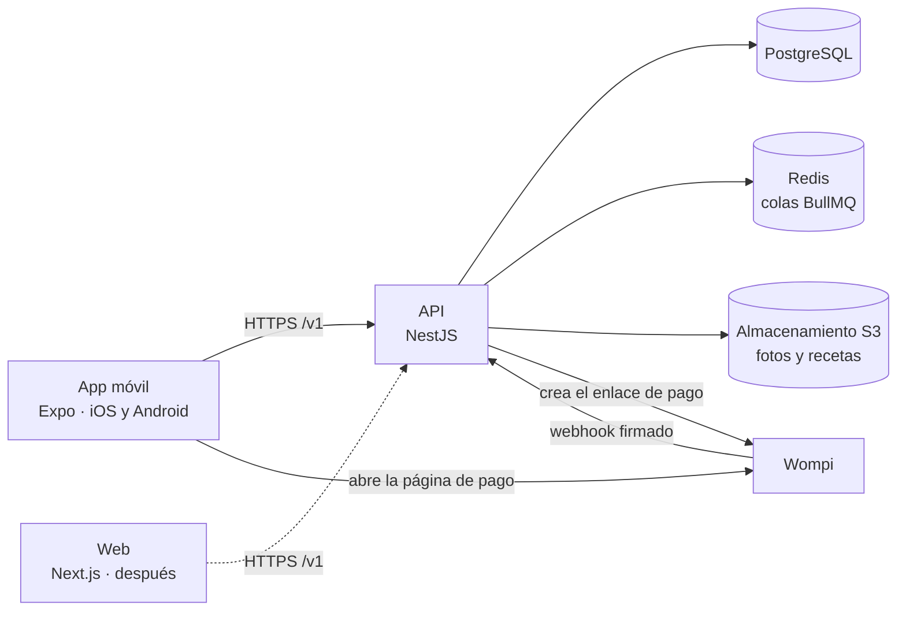

# Pawie Care: arquitectura y stack técnico

**Versión:** 0.1 · **Fecha:** 2026-10-17 · **Estado:** aprobado para empezar el scaffolding

Las reglas de negocio están en [reglas-de-negocio.md](reglas-de-negocio.md). Este documento cubre cómo se construye.

## 1. Resumen

- **Clientes:** una **app móvil para iOS y Android**, que es la de la demo, y más adelante una **web**. Ambos consumen la misma API.
- **Backend:** una sola API REST con versión (`/v1`), hecha como un monolito dividido en módulos.
- **Demo:** corre en emuladores: Android Studio en Windows y el simulador de iOS (Xcode) en Mac.
- Se prioriza un stack profesional y mantenible, aunque cueste un poco más de configurar que uno simple.



## 2. Estructura del repositorio

```
pawie-care/
├── apps/
│   ├── api/            @pawie/api: API (NestJS)
│   ├── mobile/         @pawie/mobile: app iOS y Android (Expo), la de la demo
│   └── web/            @pawie/web: web (Next.js), después
├── packages/
│   └── api-client/     @pawie/api-client: cliente generado desde el OpenAPI de la API
├── docs/               reglas de negocio, arquitectura y decisiones
├── docker-compose.yml  infraestructura local
├── package.json        scripts de la raíz y versión fija de pnpm
├── pnpm-workspace.yaml
└── turbo.json          tareas de Turborepo
```

- Sigue la convención oficial de Expo y de Turborepo: `apps/` para lo que se despliega o se instala, y `packages/` para el código compartido. Metro, Turborepo y pnpm esperan esta forma.
- **pnpm 12** con workspaces y **Turborepo 2**, que corre en orden y con caché las tareas de todos los paquetes (`pnpm lint`, `pnpm test`, etc.).
- Cada paquete tiene su propio `tsconfig.json`; no hay uno en la raíz.
- La API no depende de ningún otro paquete del repositorio y se comunica con los clientes solo a través de su contrato OpenAPI. Por eso Prisma y la base de datos viven dentro de `apps/api` y no en un paquete compartido.
- `packages/api-client` se crea cuando la API publique su OpenAPI, y `apps/web` cuando empiece la web.

## 3. Stack por capa

Versiones estables al 2026-10-17. Al crear cada proyecto se fijan en sus archivos de dependencias.

### 3.1 Backend

| Necesidad                | Elección                                    | Notas                                                                                           |
| ------------------------ | ------------------------------------------- | ----------------------------------------------------------------------------------------------- |
| Entorno de ejecución     | Node.js 24 LTS                              |                                                                                                 |
| Framework                | NestJS 12                                   | Organiza el código por módulos con inyección de dependencias                                    |
| Base de datos            | PostgreSQL 18                               |                                                                                                 |
| ORM y migraciones        | Prisma 7.10                                 | **No usar la 8**: su etiqueta `latest` en npm apunta a una versión candidata (`8.0.0-rc`)       |
| Colas y tareas diferidas | BullMQ + Redis 8                            | Para los plazos de las reservas (RN-RES-06, RN-RES-07) y la liberación de pagos (RN-PAG-03)     |
| Autenticación            | Passport + JWT, contraseñas con argon2id    | Token de acceso de vida corta y refresh token que cambia en cada uso                            |
| Validación               | class-validator + class-transformer         | Los mismos DTO generan el esquema OpenAPI                                                       |
| Contrato de la API       | @nestjs/swagger, que exporta `openapi.json` | De ese archivo se genera `packages/api-client`                                                  |
| Seguridad HTTP           | helmet, @nestjs/throttler, CORS restringido | Límite de intentos en el inicio de sesión                                                       |
| Logs                     | pino (nestjs-pino)                          | En formato JSON y sin datos sensibles                                                           |
| Errores                  | Sentry                                      |                                                                                                 |
| Lint                     | oxlint con reglas que usan los tipos        | Viene con NestJS 12                                                                             |
| Pruebas                  | Vitest, Supertest y Testcontainers          | NestJS 12 ya trae Vitest. Las pruebas de integración corren contra un PostgreSQL real en Docker |

### 3.2 App móvil (demo)

| Necesidad          | Elección                                                              | Notas                                                                                            |
| ------------------ | --------------------------------------------------------------------- | ------------------------------------------------------------------------------------------------ |
| Framework          | Expo SDK 58 (React Native 0.88)                                       | iOS y Android desde un solo código                                                               |
| Navegación         | Expo Router                                                           | Las rutas se definen con la estructura de carpetas                                               |
| Estilos            | NativeWind 4.2                                                        | Usa las clases de Tailwind, igual que la web. **No usar la 5**, que está en versión candidata    |
| Componentes        | React Native Reusables                                                | Una versión de shadcn/ui para móvil, que se puede adaptar a nuestro diseño                       |
| Formularios        | React Hook Form + Zod                                                 |                                                                                                  |
| Datos del servidor | TanStack Query con el cliente de `packages/api-client`                | Caché, reintentos y estados de carga sin escribirlos a mano                                      |
| Sesión             | expo-secure-store                                                     | Guarda el refresh token en el llavero seguro del teléfono (Keychain en iOS, Keystore en Android) |
| Pago               | expo-web-browser                                                      | Abre la página de pago de Wompi dentro de la app (ver sección 6)                                 |
| Fotos y documentos | expo-image-picker, expo-document-picker, expo-image                   | Foto de la mascota e indicaciones del veterinario                                                |
| Animación de 5 s   | Reanimated o lottie-react-native                                      | Lottie si se diseña una ilustración animada                                                      |
| Fechas             | date-fns + @date-fns/tz                                               | Se muestran siempre en la zona `America/El_Salvador`                                             |
| Errores            | @sentry/react-native                                                  |                                                                                                  |
| Lint               | ESLint 9 con eslint-config-expo                                       | Los plugins de Expo todavía no son compatibles con ESLint 10                                     |
| Pruebas            | Jest + React Native Testing Library, y Maestro para el flujo completo | Maestro recorre la demo: registro, mascota, búsqueda, reserva y pago                             |
| Compilación        | Development build (expo-dev-client), con EAS Build cuando haga falta  | Expo Go solo para pruebas rápidas                                                                |

### 3.3 Web (después)

Next.js 16 (App Router, React 19), Tailwind CSS 4 y shadcn/ui, con el mismo `packages/api-client`. Se usa Next.js y no la web que genera Expo porque los perfiles públicos de cuidadores tienen que aparecer en Google y la experiencia tiene que sentirse como una web de verdad. Entre móvil y web se comparte la lógica, no las pantallas.

### 3.4 Código compartido: `packages/api-client`

- **Orval** genera este paquete a partir del `openapi.json` del backend. Incluye tipos TypeScript, un cliente basado en `fetch`, hooks de TanStack Query y esquemas Zod.
- Nadie lo edita a mano: si el backend cambia, se vuelve a generar. Si un cambio rompe el contrato, la app deja de compilar y el error se ve antes de llegar al usuario.

### 3.5 Infraestructura

| Necesidad            | Elección                                                                                                                                                                                                                                          |
| -------------------- | ------------------------------------------------------------------------------------------------------------------------------------------------------------------------------------------------------------------------------------------------- |
| Entorno local        | Docker Compose con PostgreSQL 18, Redis 8 y Mailpit (para ver los correos). El almacenamiento compatible con S3 se agrega junto con el módulo de archivos; será SeaweedFS u otro equivalente, porque MinIO archivó su edición comunitaria en 2026 |
| Webhooks en local    | Túnel con cloudflared, para que Wompi pueda llegar a la máquina de quien desarrolla                                                                                                                                                               |
| Backend de la demo   | Railway o Render, con la API, PostgreSQL y Redis administrados                                                                                                                                                                                    |
| Archivos             | Cloudflare R2 (compatible con S3)                                                                                                                                                                                                                 |
| Correo               | Resend                                                                                                                                                                                                                                            |
| Integración continua | GitHub Actions: lint, revisión de tipos, pruebas y build                                                                                                                                                                                          |

## 4. Decisiones de arquitectura

1. **Monolito dividido en módulos, no microservicios.** Cada módulo tiene fronteras claras y se podría separar después. A esta escala, los microservicios solo agregan costo.
2. **Las reglas de negocio viven solo en el backend:** precios, clasificación Normal o Especial, quién puede tomar una reserva y transiciones de estado. Los clientes muestran resultados, no los calculan.
3. **La API tiene versión desde el día uno (`/v1`).** Una app instalada no se puede obligar a actualizar, así que un cambio incompatible va en `/v2` y `/v1` sigue funcionando.
4. **La autenticación sirve a dos tipos de cliente.** El móvil manda el token en el header `Authorization` y guarda el refresh token en secure-store. La web usa cookies `httpOnly`. Los endpoints son los mismos.
5. **El dinero se guarda en centavos enteros**, nunca con decimales flotantes. Los porcentajes van en puntos básicos (1500 = 15%).
6. **Las fechas se guardan en UTC** (`timestamptz`) y se muestran en `America/El_Salvador`.
7. **Las reservas tienen una máquina de estados explícita**, con una tabla de transiciones permitidas basada en la sección 8.2 de las reglas y un test para cada transición. Cualquier otra transición se rechaza.
8. **La base de datos impide las reservas dobles** con una restricción de exclusión de PostgreSQL (`btree_gist`) sobre cuidador y rango de horario. Prisma no puede expresar esta restricción, así que va en una migración SQL escrita a mano (RN-CUI-15).
9. **Cada reserva guarda una copia de los precios y comisiones** del momento en que se confirmó (RN-PRE-07). Los parámetros viven en una tabla, y cada cambio registra quién lo hizo, cuándo y qué valor tenía antes.
10. **Los plazos se manejan con tareas diferidas de BullMQ.** Por ejemplo, cuando una reserva pasa a `PENDIENTE_DE_PAGO` se agenda una tarea que la vence si no se paga en el plazo. Antes de actuar, la tarea vuelve a revisar el estado, para que una reserva ya pagada no se venza por error.
11. **Los archivos médicos van en un bucket privado.** Se suben y se abren con URLs firmadas de vida corta.
12. **El código se escribe en inglés y la documentación en español.** Ver el glosario de la sección 8.

## 5. Módulos del backend

| Módulo          | Responsabilidad                                                             | Reglas                   |
| --------------- | --------------------------------------------------------------------------- | ------------------------ |
| `auth`          | Registro, inicio de sesión y tokens                                         | RN-CTA-01, RN-CTA-02     |
| `users`         | Cuentas y roles                                                             | RN-CTA                   |
| `caregivers`    | Perfil, certificaciones, distritos, disponibilidad y Reserva inmediata      | RN-CUI                   |
| `pets`          | Mascotas, indicaciones del veterinario y clasificación del nivel de cuidado | RN-MAS                   |
| `catalog`       | Especies, servicios y distritos                                             | RN-MAS-01, RN-SER        |
| `settings`      | Parámetros configurables y su historial de cambios                          | Sección 15 de las reglas |
| `pricing`       | Cálculo del precio de una reserva                                           | RN-PRE                   |
| `bookings`      | Búsqueda de cuidadores, solicitudes, estados y plazos                       | RN-RES                   |
| `payments`      | Integración con Wompi y webhooks                                            | RN-PAG                   |
| `files`         | Subida y acceso a archivos                                                  | RN-MAS-08                |
| `notifications` | Correos y, más adelante, notificaciones push                                |                          |

## 6. Integración con Wompi

- **Autenticación:** OAuth2 con client credentials. Se pide un token con `POST https://id.wompi.sv/connect/token` (`grant_type=client_credentials`, `audience=wompi_api`, App ID y API Secret). El token dura 1 hora, así que se guarda y se reutiliza.
- **Cobro:** se usa **Enlace de Pago** (`POST /EnlacePago`) con `identificadorEnlaceComercio` igual al ID de la reserva. La app lo abre con `expo-web-browser`.
  - Los datos de la tarjeta nunca pasan por nuestra app ni por nuestros servidores, lo que reduce las obligaciones de seguridad PCI al mínimo.
  - Por ser un servicio físico, Apple y Google exigen cobrar por fuera de sus tiendas, así que no se llevan comisión.
- **Vuelta a la app:** el redirect de Wompi apunta a `https://<api>/v1/payments/return`, que redirige a `pawie://payment/result`. Falta confirmar si Wompi acepta directamente un esquema propio de la app.
- **Confirmación:** una reserva pasa a `CONFIRMADA` **solo por el webhook**, nunca por el redirect. El webhook se procesa así:
  1. Se verifica la firma: el header `wompi_hash` debe coincidir con un HMAC-SHA256 del cuerpo tal como llegó, calculado con el API Secret. Por eso NestJS se configura con `rawBody: true`.
  2. Se descarta si el `IdTransaccion` ya se procesó, así un webhook repetido no confirma dos veces.
  3. Se consulta la transacción con `GET /TransaccionCompra/{id}` para comprobar que está aprobada antes de confirmar.
- **Pruebas:** las transacciones de prueba traen `esReal = false`.
- **Limitaciones confirmadas:** la API no tiene endpoint de reembolso (RN-PAG-05), y los cobros con tarjeta guardada piden el CVV cada vez (RN-EME-04).

## 7. Entornos y demo

| Entorno | Backend                                                 | Clientes                                                                                                         |
| ------- | ------------------------------------------------------- | ---------------------------------------------------------------------------------------------------------------- |
| Local   | Docker Compose, con túnel cloudflared para los webhooks | Emulador de Android: la API está en `http://10.0.2.2:<puerto>`. Simulador de iOS: en `http://localhost:<puerto>` |
| Demo    | Railway o Render, con URL pública                       | La app en los emuladores apunta a la API desplegada                                                              |

- **¿Por qué desplegar el backend para la demo?** Wompi necesita una URL pública para enviar webhooks, y así quien prueba en Android (Windows) y quien prueba en iOS (Mac) ven los mismos datos.
- **Android:** emulador de Android Studio en Windows, con `npx expo run:android` para la development build.
- **iOS:** simulador de Xcode en Mac, con `npx expo run:ios`. El simulador **no requiere** el Apple Developer Program.
- **Publicar en tiendas (después):** el Apple Developer Program cuesta $99 al año; si se registra a nombre de una empresa, Apple pide un número D-U-N-S, que puede tardar semanas. Google Play cuesta $25 en un solo pago. Las compilaciones para tienda se hacen con EAS Build.

## 8. Convenciones

- TypeScript en modo `strict` en todos los paquetes.
- Prettier formatea todo el repositorio con una sola configuración en la raíz. Husky y lint-staged lo corren sobre los archivos modificados antes de cada commit.
- Lint: oxlint en la API y ESLint en la app móvil, cada uno con la configuración por defecto de su framework.
- Commits con formato convencional (`feat:`, `fix:`, `docs:`…).
- Los secretos van en variables de entorno y nunca se suben al repositorio. Cada paquete tiene un `.env.example`.
- **Idioma:** el código (identificadores, tablas, endpoints) va en inglés; la documentación y los textos de la app, en español. Glosario:

| Español (docs y app)                                                                                                                                                                  | Inglés (código)                                                                                                                                                      |
| ------------------------------------------------------------------------------------------------------------------------------------------------------------------------------------- | -------------------------------------------------------------------------------------------------------------------------------------------------------------------- |
| Dueño                                                                                                                                                                                 | Owner                                                                                                                                                                |
| Cuidador                                                                                                                                                                              | Caregiver                                                                                                                                                            |
| Mascota                                                                                                                                                                               | Pet                                                                                                                                                                  |
| Reserva                                                                                                                                                                               | Booking                                                                                                                                                              |
| Visita a domicilio                                                                                                                                                                    | Home visit                                                                                                                                                           |
| Pernocta                                                                                                                                                                              | Overnight stay                                                                                                                                                       |
| Cuidado Normal / Especial                                                                                                                                                             | Standard / Special care                                                                                                                                              |
| Certificación ⭐                                                                                                                                                                      | Special care certification                                                                                                                                           |
| Reserva inmediata                                                                                                                                                                     | Instant booking                                                                                                                                                      |
| Indicaciones del veterinario                                                                                                                                                          | Vet instructions                                                                                                                                                     |
| Bitácora                                                                                                                                                                              | Care log                                                                                                                                                             |
| Garantía Pawie                                                                                                                                                                        | Pawie Guarantee                                                                                                                                                      |
| Distrito                                                                                                                                                                              | District                                                                                                                                                             |
| Estados: `SOLICITADA`, `PENDIENTE_DE_PAGO`, `CONFIRMADA`, `EN_CURSO`, `FINALIZADA`, `CERRADA`, `RECHAZADA`, `EXPIRADA`, `CANCELADA_POR_DUENO`, `CANCELADA_POR_CUIDADOR`, `EN_DISPUTA` | `REQUESTED`, `PENDING_PAYMENT`, `CONFIRMED`, `IN_PROGRESS`, `COMPLETED`, `CLOSED`, `REJECTED`, `EXPIRED`, `CANCELLED_BY_OWNER`, `CANCELLED_BY_CAREGIVER`, `DISPUTED` |

## 9. Pendientes técnicos

| Tema                  | Qué falta                                                                                                                        |
| --------------------- | -------------------------------------------------------------------------------------------------------------------------------- |
| Credenciales de Wompi | Registrar el negocio en el panel de Wompi para obtener el App ID y el API Secret de prueba. Sin ellos no se puede probar el pago |
| Redirect de Wompi     | Confirmar si acepta `pawie://` o si hace falta la página intermedia (sección 6)                                                  |
| Hosting de la demo    | Elegir entre Railway y Render                                                                                                    |
| Animación de 5 s      | Decidir si se usa Reanimated o Lottie, según el diseño                                                                           |
| Repositorio remoto    | Crear un repositorio privado en GitHub para trabajar con quienes prueban en Mac                                                  |
