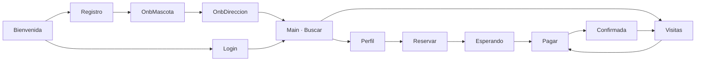

# Diseño de la app móvil

Mockups de alta fidelidad de la app del dueño (iPhone, 390 × 844) y tokens del design system **Pawie Care**. Son la referencia visual y de textos para `apps/mobile`.

> **Reglas v0.5:** los mockups de esta carpeta son de la v0.4. Antes de programar las etapas 6 a 12b de [plan-v0.5.md](../plan-v0.5.md) hay que actualizar los del dueño y crear los del cuidador. La lista está en [Pantallas para la v0.5](#pantallas-para-la-v05).

> **Los mockups son referencia, no código para copiar.** Están en HTML. La app se construye con Expo + React Native y Expo Router. Si un mockup contradice [las reglas de negocio](../reglas-de-negocio.md) o el contrato [`apps/api/openapi.json`](../../apps/api/openapi.json), mandan las reglas y el contrato.

## Contenido

| Archivo             | Qué es                                                                       |
| ------------------- | ---------------------------------------------------------------------------- |
| `tokens.json`       | Colores, tipografía (Nunito), espaciado, radios y sombra                     |
| `screens/*.dc.html` | Una pantalla por archivo. El estilo está inline y los textos son los finales |

## Pantallas y flujo

| Archivo                | Pantalla                                          | Endpoints principales                                |
| ---------------------- | ------------------------------------------------- | ---------------------------------------------------- |
| `Bienvenida.dc.html`   | Bienvenida con Nimbus "hola"                      | (ninguno)                                            |
| `Registro.dc.html`     | Crear cuenta                                      | `POST /v1/auth/register`                             |
| `Login.dc.html`        | Iniciar sesión, con estado de error               | `POST /v1/auth/login`                                |
| `OnbMascota.dc.html`   | Onboarding 1/2: registrar la mascota              | `GET /v1/catalog`, `POST /v1/pets`, `POST /v1/files` |
| `OnbDireccion.dc.html` | Onboarding 2/2: dirección                         | `POST /v1/addresses`                                 |
| `Main.dc.html`         | Pestaña Buscar: buscador, filtros y resultados    | `POST /v1/caregivers/search`, `GET /v1/users/me`     |
| `Perfil.dc.html`       | Perfil del cuidador con galería de 3 fotos        | `GET /v1/caregivers/{id}`                            |
| `Reservar.dc.html`     | Paso 1: revisar y enviar la solicitud             | `POST /v1/bookings/quote`, `POST /v1/bookings`       |
| `Esperando.dc.html`    | Paso 2: el cuidador responde (`REQUESTED`)        | `GET /v1/bookings/{id}`                              |
| `Pagar.dc.html`        | Paso 3: pagar (`PENDING_PAYMENT`)                 | `POST /v1/bookings/{id}/payments`                    |
| `Confirmada.dc.html`   | Visita confirmada (`CONFIRMED`) con Nimbus "hola" | `GET /v1/bookings/{id}`                              |
| `Visitas.dc.html`      | Pestaña Mis visitas, con estado vacío             | `GET /v1/bookings`                                   |

## Reglas del design system

- Cada pantalla tiene **un solo botón primario** (`grape-deep`).
  - Si una lista puede tener varias acciones primarias, solo la más urgente lleva el botón primario y las demás, el secundario. Por ejemplo, en Visitas, con dos reservas por pagar, solo la que vence antes muestra "Pagar" en primario.
- No se usa naranja. `butter` es solo para la ⭐ y para avisos reales.
- Los pasteles (`grape`, `sage`, `sky`) son superficies y siempre llevan texto `ink`.
- El texto más pequeño es `caption` (13 px). Las áreas táctiles miden al menos 48 px.
- Nimbus aparece como máximo una vez por pantalla, nunca en listas ni formularios.

## Cómo leer los `.dc.html`

- El bloque `<script type="text/x-dc">` es la lógica del prototipo. Muestra los estados interactivos: selección de mascotas, cálculo del precio, aceptación simulada a los 5 s.
- `{{valor}}` es un dato que llega de ese script. En la app, ese dato viene de la API o del estado.
- `<sc-if>` y `<sc-for>` son condicionales y listas.
- Los props de `data-props` (`showError`, `primeraReserva`, `sinVisitas`) activan estados alternos: error de login, primera reserva y lista vacía.

## Pendientes conocidos

- **Galería de 3 fotos:** el backend solo tiene `photoUrl`. Falta agregar `photos: [{ fileId, caption }]` (máximo 3) a `CaregiverProfile`.
- **Recuperar contraseña:** el enlace aparece en el login, pero el endpoint no existe. La app todavía no lo muestra.
- **Términos y Aviso de privacidad:** Registro los nombra como texto, sin enlace, porque esas páginas no existen.
- **Mis mascotas y Cuenta no tienen mockup**, aunque están en la barra de pestañas. En la app, Mis mascotas se hizo con el design system: una tarjeta por mascota (foto o inicial, especie, raza y edad), un estado vacío y "Agregar mascota". Cuenta solo muestra el nombre, el correo y "Cerrar sesión".
- **Perfil de la mascota:** OnbMascota dice "Agrégalo luego en su perfil", pero la app todavía no tiene la pantalla de la mascota con sus tareas de cuidado, vacunas e indicaciones del veterinario.
- **Género en la ⭐:** el mockup dice "⭐ Certificada", pero la API no dice si el cuidador es hombre o mujer. La app muestra "⭐ Con certificación".
- **Avisos:** Esperando y Confirmada dicen "Te avisamos", pero la app no tiene notificaciones push. Esperando dice que la pantalla cambia sola, porque vuelve a preguntar mientras está abierta.
- **Mockups de la etapa 6:** `Main`, `Perfil`, `Reservar` y `Pagar` siguen en la v0.4. La app ya tiene los filtros (una hoja con nivel mínimo, certificaciones y calificación mínima), el nivel en cada resultado, el perfil con nivel, insignias, certificaciones y habilidades, la tarifa tachada en $0.00 con "Primer servicio" y el aviso con los días que quedan; falta dibujarlos en `screens/`.
- **Varias visitas o noches:** la búsqueda pide una sola visita o una sola noche. La API acepta varias (RN-SER-03).
- **Nombre de la dirección:** se guarda siempre como "Casa".
- **Barra de pestañas:** en la app flota sobre el borde inferior, con las esquinas redondas, en lugar de pegarse al borde como en Main y Visitas.
- **Nivel de cuidado en Mis mascotas:** no se muestra si una mascota es Normal o Especial, ni que no se puede reservar (por ejemplo, si necesita insulina). Depende de las fechas de cada servicio (RN-MAS-05) y la API solo lo calcula en la búsqueda.
- **Aviso de cuidado especial en Main:** el mockup nombra a la mascota ("Mishi necesita cuidado especial"), pero la búsqueda devuelve el `careLevel` de todas las mascotas juntas, no cuál es la especial.
- **Nimbus:** está dibujado en SVG inline. Hay que reemplazarlo por los assets finales (`nimbus-hola.svg`, `nimbus-durmiendo.svg`).
- **Fotos de cuidadores:** son marcadores `[Foto N]`.

## Pantallas para la v0.5

Mismo design system y mismas reglas de arriba. Cada pantalla nueva lleva su `.dc.html` en `screens/` y una fila en las tablas de [Pantallas y flujo](#pantallas-y-flujo) cuando esté lista.

### Del dueño: cambiar

| Pantalla    | Qué cambia                                                                              | Reglas    | Etapa |
| ----------- | --------------------------------------------------------------------------------------- | --------- | ----- |
| `Main`      | Paseo como servicio (los filtros, el nivel y el aviso de la etapa 6 ya están en la app) | RN-SER-05 | 8     |
| `Esperando` | Ya no simula la aceptación: espera la respuesta real del cuidador                       | RN-RES-06 | 9     |

### Del dueño: nuevas

| Pantalla        | Qué muestra                                                                                        | Reglas                | Etapa |
| --------------- | -------------------------------------------------------------------------------------------------- | --------------------- | ----- |
| `MascotaPerfil` | Ficha completa: datos, rutina, horarios de comida y medicinas, salud, tareas de cuidado y celo     | RN-MAS-02, RN-MAS-11  | 7     |
| `Seguimiento`   | El servicio en una sola pantalla: estado, tareas hechas, fotos y, en un paseo, el mapa con la ruta | RN-EJE-05 a RN-EJE-07 | 10    |
| `Calificar`     | Estrellas y comentario al terminar                                                                 | RN-RSE-01             | 10    |
| `Ayuda`         | Asistente de opciones guiadas, con Nimbus, y el centro de ayuda                                    | §17                   | 12a   |
| `Reclamo`       | Reclamar la garantía de una reserva, con el plazo que queda                                        | RN-GAR-01, RN-GAR-02  | 12b   |

### Del cuidador: nuevas

Las pestañas del modo cuidador son **Inicio**, **Agenda**, **Ganancias** y **Cuenta** (RN-CTA-06).

| Pantalla        | Qué muestra                                                                                                    | Reglas               | Etapa |
| --------------- | -------------------------------------------------------------------------------------------------------------- | -------------------- | ----- |
| `CuiActivar`    | Desde Cuenta: qué pide Pawie para ser cuidador y botón para empezar                                            | RN-CTA-06            | 9     |
| `CuiDocumentos` | Subir DUI, selfie y antecedentes, con el estado de la revisión                                                 | RN-CUI-01, RN-CUI-03 | 9     |
| `CuiCurso`      | Módulos del curso de bienvenida y examen, con el resultado y la opción de repetir                              | RN-CUI-02            | 9     |
| `CuiInicio`     | Nivel actual, lo que falta para el siguiente y las solicitudes pendientes, la más urgente primero              | RN-NIV-05, RN-RES-11 | 9     |
| `CuiSolicitud`  | Mascotas con su ficha, celo o Especial, servicio, fechas, distrito y **lo que va a ganar**. Aceptar o rechazar | RN-RES-11, RN-CTA-04 | 9     |
| `CuiAgenda`     | Próximos servicios por día, con "Agregar al calendario"                                                        | RN-CAL-01            | 9, 11 |
| `CuiPerfil`     | Editar foto, descripción, habilidades, distritos, horario semanal, Reserva inmediata y pausa                   | RN-CUI-18, RN-CUI-20 | 9     |
| `CuiPrecios`    | Precio por servicio con el rango de su nivel y el sugerido como guía                                           | RN-CUI-17, RN-PRE-01 | 9     |
| `CuiServicio`   | Servicio en curso: check-in, ficha, tareas del tramo, fotos, ruta del paseo y check-out                        | §11                  | 10    |
| `CuiGanancias`  | Por cobrar, pagado (simulado en la demo) y total del mes                                                       | RN-PAG-03, RN-PAG-10 | 9     |
| `CuiCompartir`  | Vista previa del texto y botón para compartir el perfil                                                        | RN-CUI-22            | 11    |

Reglas para las pantallas del cuidador:

- **Un solo botón primario.** En `CuiSolicitud` es **Aceptar**; Rechazar va en secundario. En `CuiServicio` es la siguiente acción del tramo: Check-in, después Tomar foto y al final Check-out.
- **Cuánto gana se muestra grande**, antes que los detalles. Es lo que decide si acepta en segundos.
- **La ⭐ solo marca el cuidado especial.** El nivel no usa `butter`: es un `Tag` en `grape`, y las demás certificaciones también son `Tag`.
- **Nimbus aparece** en `CuiInicio`, en el estado vacío de solicitudes, y en `CuiCurso` al aprobar. No aparece en `CuiServicio`, que tiene que ser rápida de leer.
