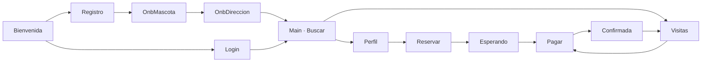

# Diseño de la app móvil

El design system de **Pawie Care** es **Placas**: la placa del collar es la señal de confianza. El nivel, las insignias y las certificaciones del cuidador se muestran como placas. La app (`apps/mobile`) lo usa desde la etapa D.

> **Si algo contradice [las reglas de negocio](../reglas-de-negocio.md) o el contrato [`apps/api/openapi.json`](../../apps/api/openapi.json), mandan las reglas y el contrato.** Los mockups son referencia, no código para copiar: la app se construye con Expo + React Native y Expo Router.

## Contenido

| Archivo                      | Qué es                                                                                    |
| ---------------------------- | ----------------------------------------------------------------------------------------- |
| `tokens.json`                | Colores, tipografía, espaciado, radios y bordes de Placas. `src/theme/tokens.ts` lo copia |
| [`directions/`](directions/) | **Referencia visual:** los mockups de Placas (Main, Perfil y CuiInicio), con sus capturas |
| `screens/*.dc.html`          | **Referencia de textos y de flujo (v0.4):** una pantalla por archivo, con el estilo viejo |

Los `.dc.html` de `screens/` son del design system anterior (Nunito, crema y morado). Ya no son referencia visual: sirven para los textos, los estados y el flujo de cada pantalla. Lo visual sale de esta página y de [`directions/`](directions/README.md).

## Design system: Placas

Elegido el 2026-11-02 en la etapa D. Las pantallas nuevas, incluidas las del cuidador (etapas 9a y 9b), se construyen con estos tokens y componentes, sin mockup en HTML.

### Tokens

Los siete primeros definen la dirección. Los demás salen de los mockups o los pidió la app.

| Token            | Valor     | Uso                                                                                    |
| ---------------- | --------- | -------------------------------------------------------------------------------------- |
| `bg`             | `#F2F5FA` | Fondo de todas las pantallas, de la barra de pestañas y de las barras inferiores       |
| `ink`            | `#25204A` | Texto, íconos, contorno de las fotos y del botón secundario, estrella de calificación  |
| `primary`        | `#3E2F9E` | Botón primario, pestaña activa y placa de Súper Cuidador. Texto encima: `white`        |
| `paseo`          | `#BDE3F7` | Solo el paseo                                                                          |
| `visita`         | `#C9EDD8` | Solo la visita                                                                         |
| `pernocta`       | `#D8CDF6` | Solo la pernocta                                                                       |
| `star`           | `#FFE07A` | Solo la ⭐                                                                             |
| `inkMuted`       | `#575272` | Texto secundario y borde de los campos. Cumple AA sobre `bg` y los colores de servicio |
| `tint`           | `#E4E0F7` | Placas de nivel y de certificación, pastilla de la pestaña activa, avisos y opciones   |
| `line`           | `#D9DEEA` | Divisores entre filas y bordes suaves. Nunca el único borde de un campo                |
| `white`          | `#FFFFFF` | Placas de insignia, chips de búsqueda, campos y las pocas superficies que agrupan      |
| `primaryPressed` | `#2F2380` | Botón primario presionado                                                              |
| `danger`         | `#A2363F` | Texto de error, borde del campo con error y acciones destructivas (6.1:1 sobre `bg`)   |
| `dangerTint`     | `#F8D0D2` | Fondo de los avisos de error, con texto `danger` (4.8:1)                               |

`danger` y `dangerTint` son los rosas del design system anterior: Placas no tenía color de error.

### Tipografía

Gabarito (`@expo-google-fonts/gabarito`, pesos 500 a 800) para títulos, precios, placas, botones y pestañas. Lexend (`@expo-google-fonts/lexend`, 400 y 600) para leer.

Lexend reemplazó a Atkinson Hyperlegible, la fuente de los mockups de Placas. El 0 de Atkinson lleva barra y en horas y precios parecía "Ø", y la versión Next tiene el mismo 0. Lexend deja el 0 sin barra y más angosto que la O, y sigue distinguiendo la I, la l y el 1. Para resaltar usa SemiBold (600), porque la Bold es muy pesada y ancha. Como Lexend es más ancha, los textos ocupan más espacio.

| Variante de `Text` | Fuente y tamaño     | Uso                                                   |
| ------------------ | ------------------- | ----------------------------------------------------- |
| `display`          | Gabarito 800, 32 px | Nombre del cuidador en el perfil, héroe de Bienvenida |
| `title`            | Gabarito 800, 30 px | Título de pantalla                                    |
| `heading`          | Gabarito 700, 20 px | Título de sección                                     |
| `subheading`       | Gabarito 700, 18 px | Nombres en las filas y en los bloques de servicio     |
| `price`            | Gabarito 800, 32 px | Precio de cada resultado                              |
| `priceSmall`       | Gabarito 800, 26 px | Precios del perfil, totales y barras inferiores       |
| `label`            | Gabarito 700, 16 px | Botones (18 en el primario), chips y etiquetas        |
| `placa`            | Gabarito 600, 14 px | Texto de las placas (13 en las listas) y pestañas     |
| `body`             | Lexend 400, 16 px   | Texto                                                 |
| `bodyStrong`       | Lexend 600, 16 px   | Resaltar, valores de un resumen y chips de búsqueda   |
| `caption`          | Lexend 400, 14 px   | Secundario, en `inkMuted`                             |
| `footnote`         | Lexend 400, 13 px   | El mínimo: la unidad bajo un precio                   |

### Radios y bordes

Cuanto más grande la superficie, más redonda. No hay sombras.

| Token         | Valor      | Uso                                                                             |
| ------------- | ---------- | ------------------------------------------------------------------------------- |
| `radius.sm`   | 12         | Opciones dentro de una hoja, muestras de color y piezas chicas                  |
| `radius.md`   | 16         | Controles: botones, placas, campos y avisos                                     |
| `radius.lg`   | 26         | Superficies grandes: bloques de servicio, hojas y placa del nivel               |
| `radius.pill` | 999        | Lo redondo: fotos de mascotas, medalla ⭐, chips de búsqueda                    |
| `borderWidth` | 1.5, 2 y 3 | Divisores y campos; botón secundario y chip elegido; bloque de servicio elegido |

El margen lateral de todas las pantallas es `gutter` (20 px).

### Componentes

Están en `apps/mobile/src/components/`. `/catalogo` los muestra todos (solo en desarrollo).

- **Placa (`Tag`):** pastilla de 32 px. Solo la de nivel lleva el agujero a la izquierda: en las demás, el punto parecía un botón de opción sin marcar. Tiene cinco variantes:
  - `badge` (insignia): blanca, con borde `ink` e ícono;
  - `certification`: en `tint`;
  - `star` (la ⭐): en `star`, con la estrella rellena;
  - `level`: en `tint`, y la de Súper Cuidador en `primary` con texto blanco;
  - `service`: en el color del servicio.

  Con `wrap`, en una cuadrícula de dos columnas, admite dos líneas. Con `size="sm"` mide 28 px y va en las listas. En las listas, la ⭐ sola es `StarMedal`, una medalla redonda de 28 px.

- **Placa del nivel (`LevelTag`):** placa grande que cuelga de una argolla en una correa `ink`. Va en el perfil y en CuiInicio.
- **Foto del cuidador (`CaregiverPhoto`):** recortada con la silueta de Nimbus (el cuerpo y la mano que saluda, de `Nimbus.tsx`) y con su contorno en `ink`. Sin foto, las iniciales sobre `tint`. Las mascotas van en círculo (`Avatar`).
- **Bloque de servicio (`ServiceBlock`):** grande, en el color del servicio, con ícono, nombre y una línea. El elegido lleva borde `ink` de 3 px y un check. Tres bloques comparten la fila, así que el nombre se achica un poco antes de partirse.
- **Fila (`Row`):** sin tarjeta, con un divisor `line` arriba (salvo la primera). El precio o la acción va a la derecha.
- **Chip (`Chip`):** dos usos.
  - Chip de búsqueda: 48 px, blanco, con borde `line` y texto `primary` de 15 px, dentro de una frase: "Para [Toby] el [mar 3 nov, 9:00] en [San Salvador]". Abre su hoja. Con varias mascotas dice "Toby y 2 más", sin foto, para que la frase quepa en dos líneas.
  - Opción (con `selected`): blanca con borde `line`; la elegida, en `tint` con borde `ink`.
- **Botones (`Button`, `IconButton`):** el primario mide 56 px, en `primary` con texto blanco. El secundario mide 48 px, con borde `ink` de 2 px. Los dos con radio 16. `IconButton` es un círculo de 48 px con borde `ink`.
- **Estado de una reserva (`Status`):** texto con ícono, sin color propio. No es una placa.
- **Marca de paso (`StepMark`):** círculo `primary` con check si el requisito o el paso está cumplido, o círculo punteado si falta. Va en los requisitos del nivel y en los pasos del alta de `CuiInicio`.
- **Aviso (`Banner`):** `info` y `success` en `tint`, cada uno con su ícono; `warning` en blanco con borde `ink`; `error` en `dangerTint` con texto `danger`.
- **Superficie (`Card`):** blanca, con borde `line`. Solo para agrupar campos o un desglose, como el precio de Reservar. Las listas son filas.
- **Barras:** `TabBar` y `BottomBar` van pegadas al borde inferior, sobre `bg` y con borde superior `line`. La pestaña activa lleva el ícono y el texto en `primary` sobre una pastilla `tint`. `BottomBar` sin monto deja el botón a todo el ancho.
- **Pantalla de formulario (`FormScreen`):** scroll, título y, con `footer`, una barra fija abajo. Se encarga del margen de la zona segura inferior: sin `footer` lo deja bajo el contenido, y con `footer` lo pone la barra.

### Reglas

- Cada pantalla tiene **un solo botón primario**. En una lista, solo lo lleva la acción más urgente y las demás van en secundario. Por ejemplo, en Visitas, con dos reservas por pagar, solo la que vence antes muestra "Pagar" en primario.
- Los colores de servicio solo marcan servicios, nunca un estado ni otra cosa.
- Los servicios siempre van en el mismo orden: paseo, visita y pernocta (`SERVICE_ORDER` en `src/theme/services.ts`). El paseo es `paseo` con el ícono `footprints`.
- `star` es solo para la ⭐. La estrella de la calificación va en `ink`. Una advertencia no es amarilla.
- No hay sombras: las superficies se separan con color, bordes o divisores.
- Están prohibidos el fondo crema, las tarjetas blancas idénticas en lista, las etiquetas en mayúsculas, los textos con "·" y los gradientes decorativos.
- Nimbus, como personaje, aparece como máximo una vez por pantalla y nunca en listas ni formularios. La silueta de las fotos no cuenta como aparición.
- Las áreas táctiles miden al menos 48 px, el contraste cumple AA y el texto mínimo es de 13 px.

## Pantallas y flujo

| Archivo                | Pantalla                                          | Endpoints principales                                |
| ---------------------- | ------------------------------------------------- | ---------------------------------------------------- |
| `Bienvenida.dc.html`   | Bienvenida con Nimbus "hola"                      | (ninguno)                                            |
| `Registro.dc.html`     | Crear cuenta                                      | `POST /v1/auth/register`                             |
| `Login.dc.html`        | Iniciar sesión, con estado de error               | `POST /v1/auth/login`                                |
| `OnbMascota.dc.html`   | Onboarding 1/2: registrar la mascota              | `GET /v1/catalog`, `POST /v1/pets`, `POST /v1/files` |
| `OnbDireccion.dc.html` | Onboarding 2/2: dirección                         | `POST /v1/addresses`                                 |
| `Main.dc.html`         | Pestaña Buscar: buscador, filtros y resultados    | `POST /v1/caregivers/search`, `GET /v1/users/me`     |
| `Perfil.dc.html`       | Perfil del cuidador con galería de 3 fotos        | `GET /v1/caregivers/{id}`                            |
| `Reservar.dc.html`     | Paso 1: revisar y enviar la solicitud             | `POST /v1/bookings/quote`, `POST /v1/bookings`       |
| `Esperando.dc.html`    | Paso 2: el cuidador responde (`REQUESTED`)        | `GET /v1/bookings/{id}`                              |
| `Pagar.dc.html`        | Paso 3: pagar (`PENDING_PAYMENT`)                 | `POST /v1/bookings/{id}/payments`                    |
| `Confirmada.dc.html`   | Visita confirmada (`CONFIRMED`) con Nimbus "hola" | `GET /v1/bookings/{id}`                              |
| `Visitas.dc.html`      | Pestaña Mis visitas, con estado vacío             | `GET /v1/bookings`                                   |

Main, Perfil, Reservar, Visitas, Mis mascotas y MascotaPerfil tienen el layout de Placas. Las demás toman el estilo por los componentes, pero conservan el layout de su mockup.

## Cómo leer los `.dc.html`

- El bloque `<script type="text/x-dc">` es la lógica del prototipo. Muestra los estados interactivos: selección de mascotas, cálculo del precio, aceptación simulada a los 5 s.
- `{{valor}}` es un dato que llega de ese script. En la app, ese dato viene de la API o del estado.
- `<sc-if>` y `<sc-for>` son condicionales y listas.
- Los props de `data-props` (`showError`, `primeraReserva`, `sinVisitas`) activan estados alternos: error de login, primera reserva y lista vacía.

## Pendientes conocidos

- **Galería de 3 fotos:** el backend solo tiene `photoUrl`. Falta agregar `photos: [{ fileId, caption }]` (máximo 3) a `CaregiverProfile`.
- **Recuperar contraseña:** el enlace aparece en el login, pero el endpoint no existe. La app todavía no lo muestra.
- **Términos y Aviso de privacidad:** Registro los nombra como texto, sin enlace, porque esas páginas no existen.
- **Mis mascotas y Cuenta no tienen mockup**, aunque están en la barra de pestañas. Mis mascotas es una lista de filas (foto en círculo, especie, raza y edad), con un estado vacío y "Agregar mascota"; cada fila abre MascotaPerfil. Cuenta muestra el nombre y el correo, la entrada al modo cuidador o el cambio de modo, las pantallas del cuidador en modo cuidador y "Cerrar sesión".
- **Vacunas:** se agregan con su nombre y sus fechas, pero la app todavía no sube la foto del carnet, que la API ya acepta.
- **Género en la ⭐:** el mockup dice "⭐ Certificada", pero la API no dice si el cuidador es hombre o mujer. La app dice "Con certificación de cuidado especial" y muestra el nombre de la certificación que da la API.
- **Avisos:** Esperando y Confirmada dicen "Te avisamos", pero la app no tiene notificaciones push. Esperando dice que la pantalla cambia sola, porque vuelve a preguntar mientras está abierta.
- **Varios paseos, visitas o noches:** la búsqueda pide un solo paseo, una sola visita o una sola noche. La API acepta varios (RN-SER-03, RN-SER-05).
- **Nombre de la dirección:** se guarda siempre como "Casa".
- **Hora:** los mockups de Placas escriben "4:00 p. m."; la app sigue con el formato de 24 horas ("16:00").
- **Nivel de cuidado en Mis mascotas:** no se muestra si una mascota es Normal o Especial, ni que no se puede reservar (por ejemplo, si necesita insulina). Depende de las fechas de cada servicio (RN-MAS-05) y la API solo lo calcula en la búsqueda.
- **Aviso de cuidado especial en Main:** el mockup nombra a la mascota ("Mishi necesita cuidado especial"), pero la búsqueda devuelve el `careLevel` de todas las mascotas juntas, no cuál es la especial.
- **Nimbus:** está dibujado en SVG inline. Hay que reemplazarlo por los assets finales (`nimbus-hola.svg`, `nimbus-durmiendo.svg`). La silueta de `CaregiverPhoto` sale del mismo SVG.
- **Fotos de cuidadores:** el seed no tiene; la app muestra las iniciales dentro de la silueta.

## Pantallas para la v0.6

Cada pantalla nueva se construye con [Placas](#design-system-placas), sin mockup en HTML, y suma su fila a las tablas de esta sección cuando esté lista.

### Del dueño: cambiar

| Pantalla    | Qué cambia                                                                              | Reglas    | Etapa        |
| ----------- | --------------------------------------------------------------------------------------- | --------- | ------------ |
| `Main`      | Paseo como servicio (los filtros, el nivel y el aviso de la etapa 6 ya están en la app) | RN-SER-05 | 8 (hecha)    |
| `Esperando` | Ya no simula la aceptación: espera la respuesta real del cuidador                       | RN-RES-06 | 9b           |
| `Registro`  | Campo opcional "¿Te recomendó un cuidador?", con el mensaje de la API si no existe      | RN-REF-03 | 11 (eventos) |

### Del dueño: nuevas

| Pantalla        | Qué muestra                                                                                        | Reglas                | Etapa     |
| --------------- | -------------------------------------------------------------------------------------------------- | --------------------- | --------- |
| `MascotaPerfil` | Ficha completa: datos, rutina, horarios de comida y medicinas, salud, tareas de cuidado y celo     | RN-MAS-02, RN-MAS-11  | 7 (hecha) |
| `Seguimiento`   | El servicio en una sola pantalla: estado, tareas hechas, fotos y, en un paseo, el mapa con la ruta | RN-EJE-05 a RN-EJE-07 | 10        |
| `Calificar`     | Estrellas y comentario al terminar                                                                 | RN-RSE-01             | 10        |
| `Ayuda`         | Asistente de opciones guiadas, con Nimbus, y el centro de ayuda                                    | §17                   | 12a       |
| `Reclamo`       | Reclamar la garantía de una reserva, con el plazo que queda                                        | RN-GAR-01, RN-GAR-02  | 12b       |

Reglas del paseo en `Main` (RN-SER-05, RN-RES-01):

- Es el primer bloque, "Solo perros". Main abre en Paseo si la primera mascota es perro, y en Visita si no, porque el paseo es el servicio más común.
- Qué especies acepta cada servicio y cuántos perros van en un paseo vienen de `GET /v1/catalog` (`speciesCodes`, `maxDogsPerWalk`). La app no copia la regla.
- Si al tocar Paseo hay un gato elegido, o más perros de los que caben, la app no cambia de servicio ni quita a nadie. Abre una hoja que nombra a cada mascota con su especie y explica el motivo. Sus opciones son "Buscar paseo para Toby" (solo si los perros elegidos caben), "Elegir perros" o "Seguir con la visita".
- Con Paseo elegido, "¿Para quién?" muestra solo los perros, con "Hasta 2 perros por paseo", y debajo dice quién no puede ir.

Reglas de `MascotaPerfil`:

- Se entra tocando una fila de Mis mascotas. Muestra la ficha por partes, en este orden: datos, rutina, horarios de comida y medicinas, salud, vacunas, tareas de cuidado y celo.
- Cada parte tiene "Editar" o "Agregar" a la derecha del título, en `ghost`, y abre su pantalla. La ficha no tiene botón primario. Cada pantalla de edición tiene "Guardar" en una `BottomBar`.
- Los datos y las partes de texto se guardan con el mismo `PUT` de la mascota, que reemplaza toda la ficha. Por eso la app manda el resto tal cual está.
- **Horarios:** cada fila muestra la hora, un ícono (cubiertos para la comida, pastilla para la medicina) y la porción o la dosis.
  - Una medicina se elige de una tarea de Medicación, y su fila muestra los días de esa tarea (RN-CUI-12).
  - Sin una tarea de Medicación, la app lleva a crearla antes de guardar la dosis.
- **"Medicamentos que toma"**, en Salud, solo informa. Su ayuda dice: "Si el cuidador tiene que dárselos, agrégalos como tarea de cuidado." Las pantallas del cuidador (9b y 10) nunca lo muestran como instrucción ni como tarea.
- **Tareas de cuidado:** lo que pide cada tarea (indicaciones del veterinario, las instrucciones del dueño o nada) sale de `careTasks` en `GET /v1/catalog`. Una tarea prohibida se marca en `danger`, porque no deja reservar mientras dure (RN-MAS-09).
- **Celo:** solo para hembras (RN-MAS-11). Un macho no ve la sección.
- No muestra si la mascota es Normal o Especial, por lo mismo que Mis mascotas: depende de las fechas de cada servicio.

### Del cuidador: nuevas

Las pestañas del modo cuidador son **Inicio**, **Agenda**, **Ganancias** y **Cuenta** (RN-CTA-06). [`directions/placas/cui-inicio.html`](directions/placas/cui-inicio.html) es la referencia de CuiInicio.

| Pantalla        | Qué muestra                                                                                                                                                            | Reglas                          | Etapa            |
| --------------- | ---------------------------------------------------------------------------------------------------------------------------------------------------------------------- | ------------------------------- | ---------------- |
| `CuiActivar`    | Desde Cuenta: qué pide Pawie para ser cuidador y botón para empezar                                                                                                    | RN-CTA-06                       | 9a (hecha)       |
| `CuiDocumentos` | Subir DUI, selfie y antecedentes, con el estado de la revisión                                                                                                         | RN-CUI-01, RN-CUI-03            | 9a (hecha)       |
| `CuiCurso`      | Módulos del curso de bienvenida y examen, con el resultado y la opción de repetir                                                                                      | RN-CUI-02                       | 9a (hecha)       |
| `CuiInicio`     | Lo que falta del alta; ya aprobado, nivel actual, lo que falta para el siguiente, el sugerido del siguiente nivel y las solicitudes pendientes, la más urgente primero | RN-NIV-05, RN-CUI-17, RN-RES-11 | 9a (hecha), 9b   |
| `CuiSolicitud`  | Mascotas con su ficha, celo o Especial, servicio, fechas, distrito y **lo que va a ganar**. Aceptar o rechazar                                                         | RN-RES-11, RN-CTA-04            | 9b               |
| `CuiAgenda`     | Próximos servicios por día, con "Agregar al calendario"                                                                                                                | RN-CAL-01                       | 9b, 11 (eventos) |
| `CuiPerfil`     | Editar foto, descripción, habilidades, distritos, horario semanal, Reserva inmediata y pausa                                                                           | RN-CUI-18, RN-CUI-20            | 9a (hecha)       |
| `CuiPrecios`    | La calculadora: precio por servicio con el rango y el sugerido de su nivel, el sugerido del siguiente nivel y lo que recibe según la API                               | RN-CUI-17, RN-PRE-01, RN-PRE-04 | 9a (hecha)       |
| `CuiServicio`   | Servicio en curso: check-in, ficha, tareas del tramo, fotos, ruta del paseo y check-out                                                                                | §11                             | 10               |
| `CuiGanancias`  | Por cobrar, pagado (simulado en la demo) y total del mes                                                                                                               | RN-PAG-03, RN-PAG-10            | 9b               |
| `CuiCompartir`  | Vista previa del texto, con su código de referido, y botón para compartir el perfil                                                                                    | RN-CUI-22, RN-REF-02            | 11 (eventos)     |

Reglas para las pantallas del cuidador:

- **Un solo botón primario.** En `CuiSolicitud` es **Aceptar**; Rechazar va en secundario. En `CuiServicio` es la siguiente acción del tramo: Check-in, después Tomar foto y al final Check-out.
- **Cuánto gana se muestra grande**, antes que los detalles. Es lo que decide si acepta en segundos.
- **Lo que gana o recibe es el monto de la API.** Ningún texto dice "recibes el 100%" (RN-PRE-04).
- **La ⭐ solo marca el cuidado especial.** El nivel es su placa (`LevelTag` en Inicio, `Tag` de nivel en las listas), y las demás certificaciones son placas `certification`.
- **Nimbus aparece** en `CuiActivar`, que es la bienvenida al modo cuidador, en `CuiInicio`, en el estado vacío de solicitudes y en `CuiCurso` al aprobar. No aparece en `CuiServicio`, que tiene que ser rápida de leer.
- **Las pestañas siguen el modo de la cuenta** (RN-CTA-06): el dueño ve Buscar, Visitas, Mascotas y Cuenta, y el cuidador ve Inicio y Cuenta. Cuenta cambia de modo, y la app abre en el último que se usó.
- **El horario semanal se edita por franjas** en `CuiPerfil`: cada día tiene mañana (7:00 a 12:00), tarde (hasta que empieza la pernocta) y noche (la de la pernocta, que sale de `GET /v1/catalog`). La API acepta cualquier ventana; las franjas son solo el editor de la app.
- **`CuiInicio` antes de aparecer en búsquedas** muestra los pasos del alta (`pendingSteps` de la API), cada uno con `StepMark`, y un solo botón primario para el siguiente paso que puede hacer el cuidador. La revisión de Pawie no tiene botón.
- **`CuiPrecios`** cambia el precio con −/+ de $0.50 dentro del rango, y pide "Recibes" a la API 400 ms después del último toque.
- **`CuiDocumentos`** guarda cada documento apenas se sube. La selfie se toma con la cámara frontal; los antecedentes también aceptan PDF. Con los cuatro subidos, la revisión empieza sola y "Listo" va en una `BottomBar` sin monto, para que se vea sin bajar en cualquier teléfono.
